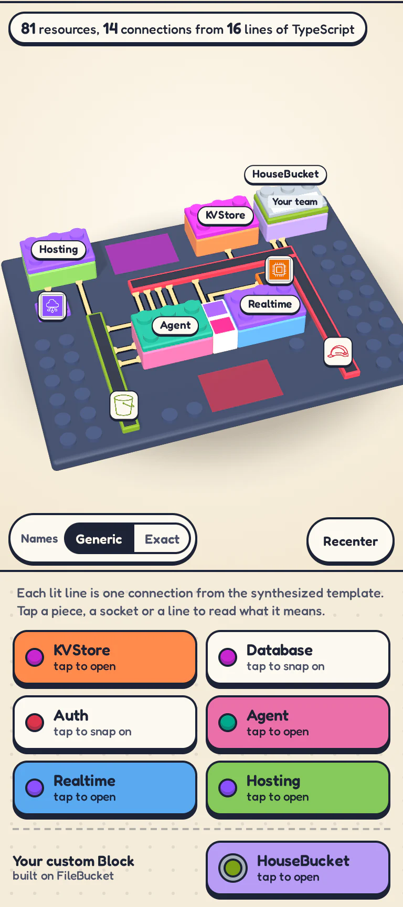
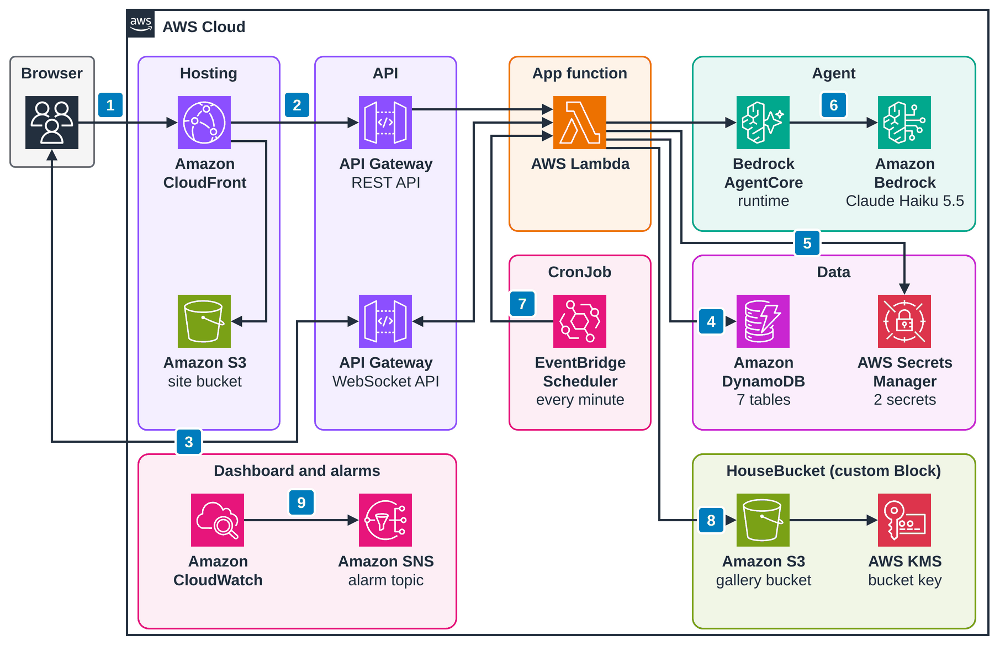

# 3D builder for AWS CDK Blocks


This is a sample app that shows what [AWS CDK Blocks](https://github.com/aws/cdk-blocks) create. Its browser tab and its stack name call it Baseplate. A visitor snaps five Blocks, the Hosting construct and one custom Block onto a baseplate in 3D and opens each one to see the AWS resources behind it. The numbers on the page come from real `cdk synth` runs that are stored in the repository as data.

The app is itself built on CDK Blocks, so it's also an example of a small deployed Blocks app: an agent, live updates, key-value stores, a scheduled job, a secret, metrics, a dashboard and static hosting. It uses release 1.0.0: the `aws-cdk-blocks` package and the packages under the `@aws-cdk-blocks` npm scope. The [AWS CDK Blocks Developer Guide](https://docs.aws.amazon.com/cdk/blocks/devguide/what-is-blocks.html) describes each Block.

This is sample code, for non-production usage. You should work with your security and legal teams to meet your organizational security, regulatory and compliance requirements before deployment. It's for learning: don't put production, personal or sensitive data in it, and give the invite link only to people you know. [Before you deploy](#before-you-deploy) has the short list, and says what this repository's security notes do and don't cover.

## What it does


The builder works in the browser with no backend call. The backend adds four things:

- An agent that picks Blocks from a one-line description of an app. It can only answer with ids from the seven pieces.
- Saved builds with share links (`?b=<id>`).
- A live gallery of the newest builds, a "build of the hour", and a count of pages that are open right now. The count is pages, not people.
- A panel that lists the Blocks and the resource count of this app's own synth.

Saving a build and asking the agent need an invite code. Everything else is open to anyone who has the URL.


There's no hosted copy of this app. To see it, run it on your machine or deploy your own.

<p align="center"> </p>

## Architecture



<ol><li>The browser loads the page from CloudFront, which serves the built files from a private S3 bucket.</li><li>API calls go through CloudFront to the API Gateway REST API (<code>/cdk-blocks/api</code>) and on to the app's one Lambda function.</li><li>Open pages hold a connection to the API Gateway WebSocket API. The function pushes new gallery builds and the here-now count back through it.</li><li>The function reads and writes seven DynamoDB tables: builds, counters, proposals, the HouseBucket's audit trail, and three that the Agent Block keeps.</li><li>It reads the invite code from Secrets Manager. A second secret there signs the Realtime Block's channel tokens.</li><li>A question for the agent runs the Amazon Bedrock AgentCore runtime, which calls Claude Haiku 5.5 in Amazon Bedrock.</li><li>EventBridge Scheduler runs the function once a minute.</li><li>That run writes the gallery snapshot to the HouseBucket's S3 bucket, which is encrypted with its own KMS key.</li><li>Three CloudWatch alarms notify an SNS topic. Nobody is subscribed until you add an address.</li></ol><p>The stack has seven S3 buckets, and the diagram draws two of them: the site bucket and the gallery bucket. The other five are an access-log bucket for each of those two, the bucket that holds the app's config file, that bucket's own log bucket, and one that the Agent Block keeps. Also in the template's 155 resources and not drawn: 13 IAM roles, 10 deploy-time helper functions, a Step Functions state machine, three CloudFront functions with an edge key-value store, a second KMS key for the alarm topic and three log groups.</p>

| Block | Job here |
|---|---|
| `Agent` | "Describe your app": picks pieces through a tool limited to the seven piece ids |
| `Realtime` | New gallery builds and the here-now count, pushed to open pages |
| `KVStore` (three stores) | `builds`, `counters` (budgets and the here-now count), `proposals` (the agent's pick per conversation) |
| `CronJob` | Once a minute: picks the build of the hour and writes the gallery snapshot when it changed |
| `HouseBucket`, a custom Block (`packages/bb-house-bucket`) | Holds `gallery/latest.json` with its own key, a retention period, access logging, required tags and an audit table. Built from `FileBucket`, `KVStore` and `Logger` |
| `Secret` | The invite code |
| `Logger`, `Metrics`, `Dashboard` | Builds saved, agent questions, refusals, snapshots |
| the Hosting construct | Serves the page (added in `cdk-blocks/index.cdk.ts`) |

Where things are:

- `cdk-blocks/index.ts` is the whole backend. `cdk-blocks/shared.ts` has the limits and schemas that the backend, the page and the tests share.
- `cdk-blocks/index.cdk.ts` is the CDK app: tags, removal policy, the API throttle, hosting and the alarms.
- `cdk-blocks/budget.ts`, `presence.ts` and `gallery-pick.ts` hold the budget counters, the here-now count and the gallery's picks as plain functions.
- `src/` is the page. `src/scene/` is the 3D scene. `src/data/` is the synth data the page shows. `src/icons/` is the icon atlas, with its own README. `src/theme-flat.ts` is the flat theme.
- `packages/bb-house-bucket/` is the custom Block, a workspace package. It isn't published to npm, and the app depends on it by path.
- `cdk-blocks/fresh-secret.ts` reads the invite code so that a running copy of the function follows a replaced secret. `cdk-blocks/handler-guards.ts` sets what the deployed function logs at which level.
- `test/` has the tests. `scripts/` has the first-run setup, the page-data splitter and the scan script.
- `assets/` has this page's screenshots and the architecture diagram. `assets/architecture.drawio` is the diagram's source; it opens in [draw.io](https://www.drawio.com/).
- `AGENTS.md` is a guide for coding agents working in this repository or a fork.
- `docs/threat-model.tc.json` is the threat model, as a [Threat Composer](https://github.com/awslabs/threat-composer) file. Import it into Threat Composer to read it.

The gallery snapshot file has no reader in the app. The scheduled job writes it to show a custom Block doing real work. The builder shows the same custom Block. Opened, it lists what each of the four standards adds or changes, and what the Block changes in the app around it:


## Prerequisites

- Node.js 22 or later, with npm.
- To deploy: an AWS account, credentials for it in your shell, and a Region where Amazon Bedrock AgentCore is available.
- CDK bootstrapped in that account and Region. `npm run deploy` checks this and prints the `npx cdk bootstrap` command when it's missing.
- Access to the agent's model in Amazon Bedrock. The agent uses Anthropic Claude Haiku 5.5 through its global inference profile, `global.anthropic.claude-haiku-5-5`, set as `AGENT_MODEL_ID` in `cdk-blocks/shared.ts`. Amazon Bedrock serves this model on demand only through an inference profile, and a global profile can send a request to any commercial Region; for requests that stay in the United States, use `us.anthropic.claude-haiku-5-5`. The notes in `@aws-cdk-blocks/bb-agent` 1.0.0 say to submit Anthropic's one-time use case details form and to activate the model's one-time AWS Marketplace subscription before first use in an account. The agent's own role can't activate it, so make the first call as a user or role that has the `aws-marketplace:Subscribe`, `aws-marketplace:Unsubscribe` and `aws-marketplace:ViewSubscriptions` permissions. Until that's done the agent answers with an error and the rest of the app works.

You don't need an AWS account to run it on your machine.

## Run it on your machine

```bash
git clone https://github.com/aws-samples/sample-3d-builder-for-aws-cdk-blocks.git
cd sample-3d-builder-for-aws-cdk-blocks
npm ci               # installs the locked versions, writes .cdk-blocks/config.json and builds the custom Block
npm run dev          # API and page on http://localhost:4340, Vite on 4440
```

Set `DEV_PORT` to use other ports, for example `DEV_PORT=5000 npm run dev`. Don't start it on a port another program holds: the dev server treats a listener on its ports as an old copy of itself and stops it. Stop the server with `npm run dev:stop -- --port 4340`.

Locally every Block runs its local implementation and keeps its data under `.cdk-blocks/local/data/`. The agent runs on the `canned` provider there: the real tool, no model, and always the same fixed pick. The page says so next to the agent box.

The local invite code is generated on the first run. To print it:

```bash
node -e "console.log(JSON.parse(require('fs').readFileSync('.cdk-blocks/local/data/settings.json','utf8'))['baseplate-invite-code'])"
```

Open `http://localhost:4340/#code=<the code>` to unlock saving and asking.

The page has a second look, a flat dark theme. Add `?theme=flat` to the address to see it.

### What `npm ci` reports

`npm ci` ends with an audit summary. On November 22, 2026 it read "found 0 vulnerabilities". The summary changes as advisories are published, so a later install can read differently.

Don't run `npm audit fix --force`: it moves pinned packages to versions this app wasn't checked with. `npm run scan` is this repository's check, and it fails on an advisory rated high or worse. An advisory the app can't fix yet goes in `osv-scanner.toml` or `.trivyignore.yaml`, with the reason and a date to look again; neither file holds one today.

## Deploy it

From your clone:

```bash
npm ci
npm run deploy
```

`npm ci` runs `scripts/setup.mjs`, which writes `.cdk-blocks/config.json` with a stack id of your own, such as `baseplate-3fa9c1`. CDK Blocks names the stack `<stack id>-prod` and derives S3 bucket names from it, and bucket names are shared by every AWS account, so each clone needs its own id. The file isn't in git. Edit it before the first deploy if you want another name.

The deploy goes to the Region the AWS CDK resolves: `region` in `cdk.json` if you add one, then `AWS_REGION` or `AWS_DEFAULT_REGION`, then the region of your AWS profile. It prints the Region on the line that starts `Deployment target`. Outside US East (N. Virginia) the CloudFront 5xx alarm is created but never fires, because CloudFront publishes its metrics only in that Region.

A first deploy took 11 minutes 32 seconds in US East (N. Virginia) on November 19, 2026, and 11 minutes 23 seconds on AWS CDK Blocks 1.0.0 on November 21, 2026, so plan for about 12 minutes. A later deploy of changed code took under 5 minutes.

The deploy prints three warnings from the Hosting construct. All three are expected:

- The alarm topic has no subscriber. That's true until you set `BASEPLATE_ALARM_EMAIL` or subscribe to the topic yourself.
- The CloudFront 5xx alarm never fires outside US East (N. Virginia), as described above.
- `minimumProtocolVersion` is ignored, because the site uses CloudFront's default certificate. "Security notes" says what that means.

The deploy prints the page's URL and writes the stack's outputs to `.cdk-blocks-sandbox/outputs.production.json`.

`npm run sandbox` deploys a second, disposable stack for development and runs the page locally against it. `npm run sandbox:destroy` removes it.

### Options

Set these in the shell for `npm run deploy`. They're read in `cdk-blocks/deploy-options.ts`.

| Variable | Default | What it does |
|---|---|---|
| `BASEPLATE_TAGS` | `project=baseplate` | Tags for every taggable resource, as `key=value,key=value`. Your value replaces the default; it doesn't add to it |
| `BASEPLATE_RETAIN_DATA` | off | `1` keeps the tables, the gallery, agent and log buckets, the gallery's key and the two secrets when the stack is destroyed, and turns on DynamoDB deletion protection |
| `BASEPLATE_ALARM_EMAIL` | none | Subscribes this address to the alarm topic. Amazon SNS sends a confirmation email first |
| `BASEPLATE_API_WAF` | off | `1` puts AWS WAF in front of the API with a limit of 300 requests per client address in five minutes. WAF bills monthly. It covers the API, not the CloudFront distribution |

Use the same values each time you deploy. A deploy without `BASEPLATE_RETAIN_DATA` after one with it switches the stack back to removing its data on destroy.

### Deploying again

Run `npm run deploy` again from the same clone to update the stack. Each running copy of the function reads the addresses of its tables, buckets and secret once, when it starts, from a config file that CDK Blocks writes during the deploy. A copy that starts in the middle of a deploy can read the old file and keep the old addresses for as long as it lives.

That matters when a deploy replaces a resource. The one resource this app has seen replaced is the invite secret, when a deploy changed its name. The backend handles that case itself: when Secrets Manager denies a read of the invite code, the function reads the config file again, takes the secret's new address and reads once more. It logs `invite secret address refreshed` at WARN when that happens. It doesn't cover a replaced table or bucket. If requests fail with access errors after a deploy that replaced one, start fresh copies of the function by changing its configuration, for example its description, with `aws lambda update-function-configuration`.

## The invite code

The code is a generated Secrets Manager secret. The stack output `InviteCodeSecretArn` names it. To read it:

```bash
STACK="$(node -p "require('./.cdk-blocks/config.json').stackId")-prod"
ARN="$(aws cloudformation describe-stacks --stack-name "$STACK" \
  --query "Stacks[0].Outputs[?OutputKey=='InviteCodeSecretArn'].OutputValue" --output text)"
aws secretsmanager get-secret-value --secret-id "$ARN" --query SecretString --output text
```

The invite link is the page's URL with the code in the fragment: `https://<your site>/#code=<the code>`. The page reads the fragment once, removes it from the address bar, keeps the code for that tab and never shows it. A share link (`?b=<id>`) carries no code.

To change the code:

```bash
aws secretsmanager put-secret-value --secret-id "$ARN" --secret-string "<a new long random value>"
```

The backend caches the secret for up to five minutes, so the old code can still work for that long.

## What it costs

These are estimates, made on November 19, 2026 and recounted against the template on November 21, 2026. Nobody has measured them on a bill. They come from counting the resources in this app's synthesized template and multiplying by the public list prices for US East (N. Virginia) on that date, listed under the tables. Prices change and differ by Region, so check https://aws.amazon.com/pricing/ before you rely on them. The AWS Free Tier can cover some of this.

While nobody uses it, the stack still bills for:

| What | Count in the template | Estimate a month |
|---|---|---|
| Customer managed KMS keys (the gallery bucket's, the alarm topic's). Both rotate yearly, and each of a key's first two rotations adds $1.00 a month | 2 | $2.00, up to $6.00 after two years |
| CloudWatch dashboard (an account's first three are free) | 1 | $3.00 |
| CloudWatch alarms (an account's first ten are free) | 3 | $0.30 |
| Secrets Manager secrets (the invite code, and the one the Realtime Block signs its channel tokens with) | 2 | $0.80 |
| The scheduled job: 43,200 runs a month of a 2,048 MB function, assumed at half a second each. A test deploy on November 19, 2026 measured a median of 16 ms | 1 | under $1 |
| DynamoDB reads by that job, S3 storage, logs, the schedule itself | | under $1 |
| Also on, and small at this size: point-in-time recovery on the seven tables, log groups kept for 365 days, and CloudFront access logs in an S3 bucket | | not estimated |
| Total | | about $6 to $10 |

Under use:

- An open page checks in every 15 seconds. That's 240 API requests an hour for each open page, which we estimate at well under one cent an hour.
- The agent is capped at 200 questions a day across everyone, with at most 4 model calls of at most 1,000 output tokens for each question. At the cap, with every call using its whole output allowance, that's 800,000 output tokens a day, and about 2 million input tokens a day at the 2,400 input tokens a call that test calls used. At Claude Haiku 5.5's prices we estimate that at about $0.60 a day if the cap is reached every day. A typical question in those tests took three calls, about 6,500 input tokens and about 600 output tokens, which is about a tenth of a cent. Each question also uses a few seconds of Amazon Bedrock AgentCore runtime time, which isn't in that estimate.
- Saves are capped at 500 a day and are a few DynamoDB writes each.

What a stranger with the URL can cost you: the reads are open, so anyone can call them in a loop. The API throttle caps all callers together at 25 requests a second, with bursts of up to 50. Held for a whole day that's about 2.2 million requests, which we estimate at $10 to $15 a day in API Gateway, Lambda and DynamoDB charges until you notice. The `ApiRequestsHigh` alarm fires when the API takes more than 2,500 requests in five minutes. It only reaches you if you set `BASEPLATE_ALARM_EMAIL` or subscribe to the alarm topic yourself. `BASEPLATE_API_WAF=1` adds a limit for each client address. Neither one caps spend. If you need a cap, add an AWS Budgets action or take the stack down.

Unit prices used, US East (N. Virginia), November 19, 2026: KMS key $1.00 a month, dashboard $3.00 a month, standard alarm $0.10 a month, secret $0.40 a month, Lambda $0.0000166667 per GB-second and $0.20 per million requests, API Gateway REST $3.50 per million requests, DynamoDB on-demand $0.125 per million read request units and $0.625 per million write request units. Claude Haiku 5.5 through the global inference profile, read on November 20, 2026: $0.10 per million input tokens and $0.50 per million output tokens for prompts of up to 100,000 tokens.

## Security notes

- The API has no authorizer. Every method is a public endpoint, by design: reads are open, and `saveBuild` and the four agent methods check the invite code in the handler before they touch a budget.
- The invite code is one shared code for everyone you give the link to. It isn't a sign-in. Anyone who has it can use up the day's 200 agent questions and 500 saves for everyone, and can fill the recent-builds strip. The "10 questions a page" limit keys on an id the browser makes up, so it slows a person down and doesn't stop a script. Change the code (see above) when the link has gone further than you wanted.
- The API throttle is shared by all callers: 25 requests a second, with bursts of up to 50. One script at the limit makes real visitors see errors. API Gateway answers 429 only past the burst, so 60 requests sent at once can all succeed.
- The here-now count can be inflated by anyone, because checking in is open. New pages share a budget of 120 joins a minute and the count stops at 200.
- The page and the gallery are open to anyone with the URL, including through the API Gateway address directly.
- Questions put to the agent are stored with their answers in the Agent Block's DynamoDB tables, with no expiry. The page says so. Saved builds hold piece ids only, and they don't expire either.
- A saved build, a gallery event and the agent's pick never carry visitor text. The agent's tool input is checked against the seven piece ids, and its reply is shown as text.
- The app's shared role is the one the app function and the AgentCore runtime both run as. `@aws-cdk-blocks/bb-agent` 1.0.0 adds statements to it that let it invoke any Bedrock AgentCore runtime in the account and Region, and call any Amazon Bedrock foundation model and inference profile. No request input reaches those calls, but the role is wider than this app needs. The template has 13 IAM roles in all. The other 12 belong to the deploy-time helper functions (10), the state machine that waits for table indexes (1) and the schedule (1).
- `npm run nag` reports cdk-nag findings. Almost all of them are on resources that the CDK Blocks constructs create, as this sample configures them at 1.0.0: wildcard IAM statements, no WAF, no API access logging, no Content-Security-Policy header. This sample doesn't change them. That describes this sample's stack and isn't a verdict on CDK Blocks; [Security in AWS CDK Blocks](https://docs.aws.amazon.com/cdk/blocks/devguide/security.html) is the upstream page, and it covers the shared role.
- The page is served on CloudFront's own domain name with CloudFront's default certificate. That certificate's security policy is fixed at TLSv1, so the distribution accepts TLS 1.0 and later. Raising the minimum needs a custom domain and certificate. The deploy prints a warning that says so.
- A refused request is one WARN line in the app function's log group, for example `Request refused: 403 InviteRequiredException (invite)`. That covers a wrong or missing invite code, invalid input, an unknown build or conversation, and a spent budget. An ERROR line there means a fault. During a first deploy the scheduled job can fire before the app's config file is readable; each such run is skipped with one WARN line. A page that closes while the function is answering it over the WebSocket is one WARN line too: `@aws-cdk-blocks/bb-realtime` 1.0.0 lets that error out of its handler, and this app's handler turns it into the warning.
- The custom Block stores a file and then records its audit entry. If the second step fails, the file is stored with no entry.
- CDK Blocks collects anonymous usage data from its command line tools (`npm run dev`, `sandbox`, `deploy` and others). It prints a notice once for each user on a machine: the first time it sends data, when it creates `~/.cdk-blocks/telemetry/installation-id`. If that file is already there from another CDK Blocks project, you see no notice. It follows the AWS CDK CLI's telemetry setting and has no switch of its own. To turn both off, run `npx cdk cli-telemetry --disable` or set `CDK_DISABLE_CLI_TELEMETRY=1`. The first command that sends data writes a project id into your `.cdk-blocks/config.json`.

## Tear it down

```bash
npm run destroy
```

Run it from the same clone you deployed from. It reads the stack id in `.cdk-blocks/config.json`, synthesizes the app with the page build that the deploy left in `dist/`, and then deletes the stack. It took 5 minutes 16 seconds on November 21, 2026, on a stack that had been used.

On a stack that has been used, expect the first attempt to fail and the command to finish anyway. Amazon S3 delivers the gallery bucket's access logs some minutes after the requests they record. A log file can land in the access-log bucket after CloudFormation emptied it and before CloudFormation deletes it, and then the delete fails with `DELETE_FAILED` and "The bucket you tried to delete is not empty". `npm run destroy` handles this itself: it empties the stack's buckets, waits 60 seconds and deletes again. It prints warnings that the other buckets no longer exist, then `Production stack destroyed on retry!`, and exits 0. This happened on both teardowns of a used stack on November 21, 2026. If you delete the stack yourself and hit the same error, empty that one bucket and delete the stack again.

If the clone or its `.cdk-blocks/config.json` is gone, delete the stack yourself. It's named `<stack id>-prod`, which starts with `baseplate-` unless you changed the id. Use the CloudFormation console, or `aws cloudformation delete-stack --stack-name <stack id>-prod`.

The `BASEPLATE_*` variables don't change what destroy removes. CloudFormation deletes each resource by the policy the last deploy gave it. Destroy still synthesizes the app, so a malformed value stops it before it deletes anything.

It doesn't ask first. By default it deletes every resource in the stack that holds data: the seven DynamoDB tables, the seven S3 buckets and their contents, the two KMS keys, the two secrets and the three log groups the template declares. AWS KMS keeps a deleted key in a 30-day waiting period before the key is gone; the template doesn't set another length.

Five of the template's 155 resources carry a `Retain` policy: five of the Hosting construct's `Custom::CDKBucketDeployment` resources (`HostingAssetDeploymentHtml`, `HostingAssetDeploymentImmutable`, `HostingAssetDeploymentMutable`, `HostingAssetDeploymentNoCache` and `HostingFontTypeDeploymentwoff2`). Each one is a record that a deploy copied part of the built page into the site bucket. They hold no data. On destroy, CloudFormation drops them from the stack without running their delete step, and the files they copied go with the site bucket.

If you deployed with `BASEPLATE_RETAIN_DATA=1`, the tables, the buckets, the gallery's key and the two secrets stay, the tables have deletion protection, and a later deploy with the same stack id fails on their names until you delete them yourself.

Three things are outside the stack and stay:

- CloudWatch log groups that Lambda creates by itself. Eight of the template's 11 functions, all deploy-time helpers, have no log group in the template, so Lambda makes one for each the first time it runs. Their names start with `/aws/lambda/<stack id>-prod`. A deploy and destroy on November 21, 2026 left seven, because one helper never ran.
- The log group that Amazon Bedrock AgentCore creates for the agent's runtime. Its name starts with `/aws/bedrock-agentcore/runtimes/` followed by the stack name without its hyphens. It has no expiry.
- The `CDKToolkit` stack from `cdk bootstrap`, and the files each deploy uploaded to its bucket.

To list the log groups that are left, search for the six hex digits of your stack id:

```bash
aws logs describe-log-groups --query "logGroups[?contains(logGroupName, '3fa9c1')].logGroupName" --output text
```

To delete them, after you've read the list and it holds only this stack's log groups:

```bash
for group in $(aws logs describe-log-groups --query "logGroups[?contains(logGroupName, '3fa9c1')].logGroupName" --output text); do
  aws logs delete-log-group --log-group-name "$group"
done
```

After that, nothing with the stack's name is left except the two KMS keys in their waiting period. `aws kms describe-key --key-id <key id> --query KeyMetadata.KeyState` reads `PendingDeletion` for each, and a key in that state isn't billed.

## Tests and checks

```bash
npm run check        # typecheck, Biome, knip, and the tests that need no server
npm run build        # always `npm run build`, never a bare `vite build`
npm run test:e2e     # API tests against the local dev server; starts one if none is running
npm run test:caps    # the daily budgets; needs the dev server stopped and starts its own
npm run test:contrast  # text contrast in a real browser, both looks, two sizes; starts a dev server if none is running
npm run own-synth    # after a change under cdk-blocks/: rewrites cdk-blocks/own-synth.json
npm run data:split   # after a change to src/data/custom.json or connections.json: rewrites src/data/page/
npm run scan         # semgrep, betterleaks, osv-scanner, trivy, npm audit, the license allowlist and the notices file
npm run nag          # cdk-nag over this app's own synth; a report, not a gate
```

`npm run scan` needs four scanners on your PATH. Their versions are pinned in `mise.toml`, and `mise install` gets them. `.github/workflows/ci.yml` runs `check`, the build, the API tests, the capability tests, the contrast test and `scan`.

Rules that are off and findings that are accepted each carry a reason where they're set: `biome.jsonc`, `knip.jsonc`, `osv-scanner.toml`, `.trivyignore.yaml`. The last two hold no accepted advisory today. The license check leaves out `parse-cache-control`, which declares "BSD" with no variant; its license file is the 3-clause text. `lefthook.yml` holds optional git hooks; nothing installs them for you.

No test in this repository calls a model. One test opens a browser: `npm run test:contrast` reads the computed color of every visible piece of text and of the background behind it, in the default look and in `?theme=flat`, at 384 px and 1440 px wide, and fails below the WCAG 2.2 AA ratios. It needs Playwright's Chromium, which `npx playwright install chromium` downloads once. It can't see the pixels of the 3D scene. `test/backend.test.ts` checks the contrast arithmetic of the flat theme's palette without a browser.

## The data

Every number the builder shows is looked up, never computed on the page. The numbers were read on November 21, 2026 from synths of `aws-cdk-blocks` 1.0.0. `src/data/` holds the results of synthesizing all 127 arrangements of the seven pieces, and all 16 states of the custom Block's four standards in the 64 arrangements that include it. `cdk-blocks/` has byte copies for the backend, and a test compares them. The `template` fields in those files name the synth-run files each number was read from. Those templates aren't in this repository, so the data can be checked against itself here but not regenerated.

## The icons and third-party software

The tiles carry AWS Architecture Icons. `src/icons/README.md` says where they come from and how to run the page without them. The screenshots and the diagram in `assets/` show the same icons.

The page uses the Fredoka and JetBrains Mono fonts from the `@fontsource` npm packages, under the SIL Open Font License 1.1. `THIRD-PARTY-LICENSES` lists the licenses of the production dependencies, and the build ships a copy with the page.

## Before you deploy

This sample is for learning. Before you deploy it:

- Don't put production, personal or sensitive data in it. Questions typed to the agent are stored with their answers, with no expiry.
- The invite link is one shared code, not a sign-in. Give it only to people you know, and change the code when the link has gone further than you wanted. "The invite code" has the command.
- What the link unlocks is capped for everyone together: the agent stops at 200 questions a day and saves stop at 500 a day. The reads need no link, and nothing caps what they can cost. "What it costs" has the estimates for both.
- Tear the stack down when you're done. "Tear it down" says what goes and what stays.

These notes, "Security notes", the threat model in `docs/` and any scan results for this repository describe this sample's own code and the choices it makes. They aren't a security statement about AWS CDK Blocks, which is a separate AWS project with its own documentation and security process:

- [Security in AWS CDK Blocks](https://docs.aws.amazon.com/cdk/blocks/devguide/security.html), in the Developer Guide.
- The [CDK Blocks repository](https://github.com/aws/cdk-blocks) and its [security policy](https://github.com/aws/cdk-blocks/security/policy).
- [AWS vulnerability reporting](https://aws.amazon.com/security/vulnerability-reporting/).

Report a problem in this sample the way "Security" below says. Report a problem in a CDK Block upstream, through that repository's security policy.

## Security

See [CONTRIBUTING](CONTRIBUTING.md#security-issue-notifications) for more information.

## License

This library is licensed under the MIT-0 License. See the LICENSE file.
