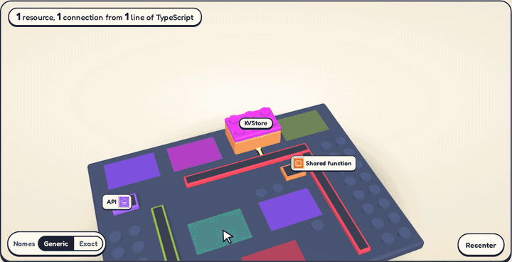
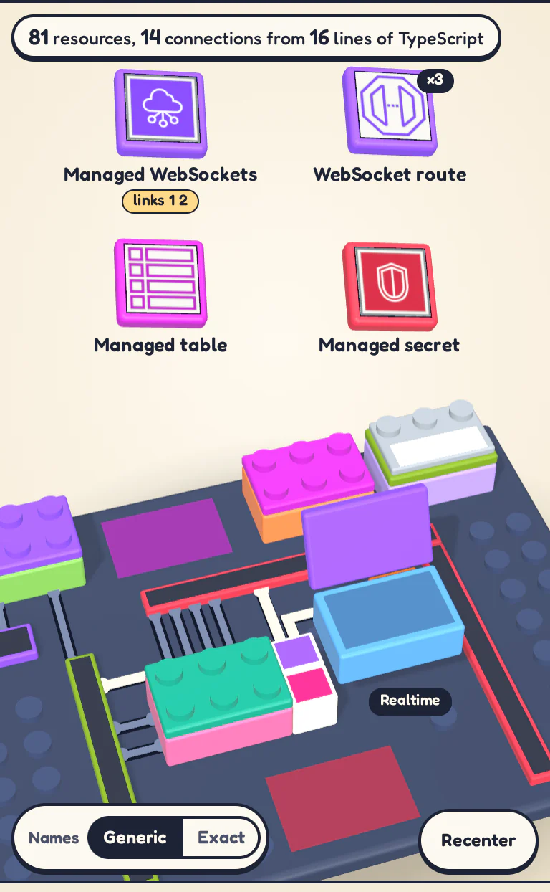

# 3D builder for AWS CDK Blocks



[AWS CDK Blocks](https://docs.aws.amazon.com/cdk/blocks/devguide/what-is-blocks.html) are AWS capabilities you import as TypeScript code: a key-value store, a database, an agent. This sample lets you snap Blocks onto a plate in 3D and open each one to see the AWS resources it creates. The counts come from real `cdk synth` runs, and the app's own backend runs on CDK Blocks.

It's sample code for learning, and it isn't meant for production use. There's no hosted copy: you run it on your machine, or deploy it to your own AWS account. The app's name is Baseplate, which you'll see in the browser tab and in the stack name.

## Why it's worth a look

A Block is a line or a few lines of code:

```ts
const todos = new KVStore(scope, 'todos');
const helper = new Agent(scope, 'helper', {
  systemPrompt: 'You are a helpful assistant.',
});
```

In the builder, that `KVStore` adds 1 resource to your app's AWS CloudFormation template and that `Agent` adds 39.

- **You see what a Block turns into.** Open a Block on the plate and you get the AWS resources behind its code, and the connections between them, such as a function's permission to read a table. The builder has seven pieces: five Blocks, the Hosting construct that comes with CDK Blocks, and one custom Block. All seven together come to 115 resources and 20 connections from 18 lines of TypeScript.
- **The numbers are measured.** Every count was read from a synthesized template and stored in the repository as data. [How the numbers are produced](#how-the-numbers-are-produced) has the detail.
- **The app runs on CDK Blocks too.** Its backend is one file, `cdk-blocks/index.ts`, and you can read it as an example of a small CDK Blocks app: an agent on Amazon Bedrock, live updates, key-value stores, a scheduled job and a custom Block.
- **It runs with no AWS account.** CDK Blocks gives every Block a local implementation, so you can try the whole app on your machine before you deploy anything.


The counts in the pictures differ because each picture has a different set of pieces on the plate. The builder also fits a phone screen:

<p align="center"> </p>

## Run it on your machine

You need [Node.js](https://nodejs.org/) 22 or later. You don't need an AWS account.

```bash
git clone https://github.com/aws-samples/sample-3d-builder-for-aws-cdk-blocks.git
cd sample-3d-builder-for-aws-cdk-blocks
npm ci
npm run dev
```

Open http://localhost:4340 and start snapping Blocks on. Stop the server with Ctrl+C, or with `npm run dev:stop -- --port 4340` from another terminal.

Building works right away. A deployed copy keeps two features behind an invite code, saving a build and asking the agent to pick Blocks for you, and the local app works the same way. The local code is generated on the first run. This prints a link that has it:

```bash
node -e "console.log('http://localhost:4340/#code=' + JSON.parse(require('fs').readFileSync('.cdk-blocks/local/data/settings.json','utf8'))['baseplate-invite-code'])"
```

On your machine the agent uses no model. It runs the same code that places Blocks on the plate, with one fixed answer, and the page says so next to the agent box. A deployed copy calls Claude Haiku 5.5 on Amazon Bedrock.


Two things to know:

- The server uses two ports, 4340 and 4440. `DEV_PORT=7340 npm run dev` moves them to 7340 and 7440, and then the link above needs 7340 too. Choose free ports, because the dev server stops any program that's listening on its two ports.
- The CDK Blocks command line tools, `npm run dev` included, send anonymous usage data. `CDK_DISABLE_CLI_TELEMETRY=1` turns that off. [Security notes](docs/security.md) says more.

## Deploy it to your own account

You need:

- An AWS account, with credentials for it in your shell. A sandbox account is the right place for a sample.
- A [Region where Amazon Bedrock AgentCore is available](https://docs.aws.amazon.com/bedrock-agentcore/latest/devguide/agentcore-regions.html), with the AWS CDK [bootstrapped](https://docs.aws.amazon.com/cdk/v2/guide/bootstrapping.html) in it. The deploy checks this and prints the command if it's missing.
- Access to Anthropic Claude Haiku 5.5 in Amazon Bedrock. The agent calls the model id `global.anthropic.claude-haiku-5-5`. The first use of the model in an account takes a one-time form and subscription, and [Before you start](docs/deploy.md#before-you-start) has the steps. You can deploy without it: the agent answers with an error until it's done, and the rest of the app works.

Then, from your clone, after `npm ci`:

```bash
npm run deploy
```

A first deploy takes about 12 minutes and prints the page's URL at the end. Saving and asking the agent need the invite code, which the stack keeps in AWS Secrets Manager. [The invite code](docs/deploy.md#the-invite-code) shows how to read it and make an invite link.

**Cost.** We estimate about $6 to $10 a month for a stack nobody uses, at US East (N. Virginia) list prices. It's an estimate, and nobody has read it off a bill. Use adds to it, and anyone who has the URL can call the app's open read endpoints, so nothing caps the cost. To get the stack's alarms by email, deploy with `BASEPLATE_ALARM_EMAIL=you@example.com npm run deploy`. [What it costs](docs/costs.md) has the arithmetic.

**Tear it down** when you're done:

```bash
npm run destroy
```

It doesn't ask first, and it removes the stack with its data. A few log groups and the CDK bootstrap stack stay behind. [Tear it down](docs/teardown.md) lists what stays and how to remove it.

[Deploy to your own account](docs/deploy.md) has the rest: the Region, the warnings a deploy prints, the options and deploying again.

## What's inside

The builder's seven pieces are the KVStore, Database, Auth, Agent and Realtime Blocks, the [Hosting construct](https://docs.aws.amazon.com/cdk/blocks/devguide/hosting.html), and a custom Block named HouseBucket. The page holds a stored synth result for each of the 127 ways to combine them.

The app's own backend is a separate CDK Blocks app. It uses some of the same Blocks and a few that the builder doesn't show:

| Block | Job here |
|---|---|
| `Agent` | Takes a one-line description of an app and picks pieces for it. Its tool can only answer with the seven piece ids |
| `Realtime` | Pushes newly saved builds and the count of open pages to every open page |
| `KVStore` (three stores) | Saved builds, the daily limits on saves and questions, and the agent's pick for each conversation |
| `CronJob` | Once a minute: picks a saved build to feature and writes a snapshot of the newest builds |
| `HouseBucket`, a custom Block | Stores that snapshot under a team's four standards |
| `Secret` | The invite code |
| `Logger`, `Metrics`, `Dashboard` | Builds saved, agent questions, refused requests, snapshots |
| the Hosting construct | Serves the page |

### The custom Block

`HouseBucket` is in `packages/bb-house-bucket`. It shows how a team can wrap its own rules into a Block. It's built from the `FileBucket`, `KVStore` and `Logger` Blocks, and it adds four standards: the team's own encryption key, a retention period, access logging and required tags. You can switch each one on and off in the builder and watch the resources change.


### Architecture

![Architecture diagram of the app's AWS stack, with nine numbered paths and a legend that describes each one. A browser loads the page from a CloudFront distribution backed by an S3 bucket. CloudFront passes API calls to an API Gateway REST API and on to one Lambda function, and open pages hold a connection to an API Gateway WebSocket API that the function pushes updates through. The function uses seven DynamoDB tables, two Secrets Manager secrets, an Amazon Bedrock AgentCore runtime that calls Claude Haiku 5.5 in Amazon Bedrock, and the HouseBucket custom Block's S3 bucket with its own KMS key. EventBridge Scheduler runs the function every minute, and CloudWatch alarms notify an SNS topic.](assets/architecture.png)

This is the app's own stack, which has 155 resources when you deploy it. The page comes from Amazon CloudFront and Amazon S3. API calls go through Amazon API Gateway to one AWS Lambda function. The function uses seven Amazon DynamoDB tables, two AWS Secrets Manager secrets and an Amazon Bedrock AgentCore runtime. Amazon EventBridge Scheduler runs the scheduled job.

[Working on the code](docs/development.md) says where each part is in the repository and how to run the tests.

## How the numbers are produced

For each of the 127 combinations of the seven pieces, we wrote the CDK Blocks app, ran `cdk synth` on it, and counted the resources and connections in the template it produced. We did the same for every on and off state of the custom Block's four standards. The results are the JSON files in `src/data/`, and the page looks every number up there.

The current data was read on November 27, 2026 from `aws-cdk-blocks` 1.0.1. The synthesized templates aren't in this repository, so you can't regenerate the builder's data here. You can produce the count for the app's own stack yourself, with `npm run own-synth`.

## Limits

This is sample code, for non-production usage. You should work with your security and legal teams to meet your organizational security, regulatory and compliance requirements before deployment.

- Don't put production, personal or sensitive data in it. Questions typed to the agent are stored with their answers, with no expiry.
- The invite link is one shared code, and it isn't a sign-in. Give it only to people you know.
- The app's read endpoints are open to anyone who has the URL. The agent stops at 200 questions a day and saves stop at 500 a day, and nothing else caps what a deployed stack can cost.
- The builder's seven pieces are fixed. A new piece needs new synth data, and the tools that made the data aren't in this repository.
- The 3D scene needs a browser with WebGPU or WebGL. Without either, the page shows a text-only version.

## Security

See [CONTRIBUTING](CONTRIBUTING.md#security-issue-notifications) for more information.

[Security notes](docs/security.md) says what to know before you deploy and share the page. The threat model is [docs/threat-model.tc.json](docs/threat-model.tc.json), a [Threat Composer](https://github.com/awslabs/threat-composer) file. Both describe this sample's own code. For AWS CDK Blocks itself, see [Security in AWS CDK Blocks](https://docs.aws.amazon.com/cdk/blocks/devguide/security.html).

## Contributing

See [CONTRIBUTING](CONTRIBUTING.md). [Working on the code](docs/development.md) has the layout, the tests and the checks, and [AGENTS.md](AGENTS.md) is the guide for coding agents.

## License

This library is licensed under the MIT-0 License. See the [LICENSE](LICENSE) file. [THIRD-PARTY-LICENSES](THIRD-PARTY-LICENSES) lists the licenses of the production dependencies. The tiles carry AWS Architecture Icons, and [src/icons/README.md](src/icons/README.md) says where they come from.
